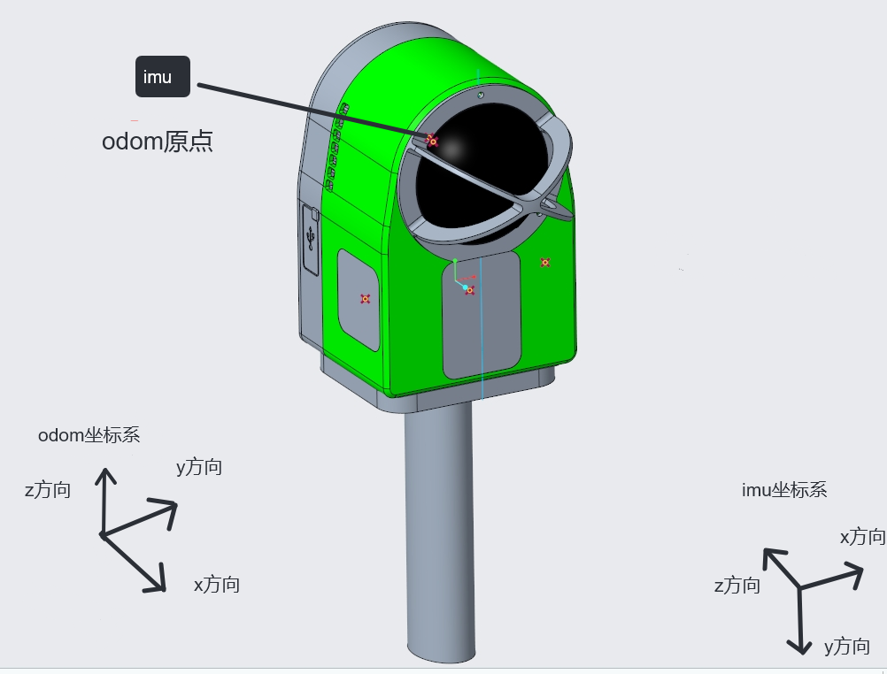

# lixel_ros：X-Brain ROS2 驱动

把 X-Brain 的定位位姿、点云、IMU 和相机图像发布成标准 ROS2 话题。

X-Brain 给机器人提供定位，装在机器人上哪个位置都可以。SDK 输出的是 IMU 坐标系，轴向由 IMU 硬件决定，不直观。本驱动用一组固定的旋转把它转成 ROS 坐标系（ODOM 坐标系）：原点默认就在扫描仪原点，手持扫描仪时 X 朝前。装到机器人上以后只需要按安装位置改平移，旋转不用改。

## 依赖

- ROS2 Humble（Ubuntu 22.04）
- CycloneDDS：`sudo apt install ros-humble-rmw-cyclonedds-cpp`（启动脚本用它）
- cv_bridge、python3-opencv（相机 JPEG 解码节点用）
- X-Brain SDK：仓库根目录的 `include/` 与 `lib/<架构>/`（`x86_64` 或 `aarch64`），本目录与它们平级，CMake 自动按架构找库

## 编译

在本目录（仓库的 `ros2/`）内直接编译，产物生成在本目录的 `build/`、`install/`、`log/`：

```bash
cd <x-brain-sdk 仓库路径>/ros2
source /opt/ros/humble/setup.bash
colcon build --packages-select lixel_ros
```

包版本（`package.xml` 的 `<version>`）必须与 SDK 头文件版本一致，不一致时 CMake 配置阶段报错。

## 启动

1. 先用 SDK 完成设备侧流程（初始化、设置初始位姿、`startRecord()` 等，用法见仓库根目录 README 的「快速开始」）。设备进入录制状态后还要完成重定位才输出定位数据。
2. 运行启动脚本，话题就发布出来了：

```bash
bash <x-brain-sdk 仓库路径>/ros2/start_lixel_ros.sh
```

驱动只订阅数据，不启停录制。Ctrl+C 只停 ROS 节点，设备照常录制。

启动脚本会自动找 SDK 动态库（`../lib/<架构>/`）和 colcon 的 `install/setup.bash`（本目录，或环境变量 `LIXEL_WS` 指定的目录）。

### 参数文件

驱动的全部参数（设备连接、坐标系、外参、话题名）都从参数文件读，默认是 `config/default_params.yaml`。launch 读的是编译后安装的那份（`install/lixel_ros/share/lixel_ros/config/default_params.yaml`），所以改了源码里的 yaml 要重新 `colcon build` 才生效。

也可以不重新编译，直接指定一份参数文件（脚本后面的参数会原样传给 launch）：

```bash
bash <x-brain-sdk 仓库路径>/ros2/start_lixel_ros.sh params_file:=/path/to/my_params.yaml
```

只覆盖设备 IP 时：`start_lixel_ros.sh device_ip:=192.168.123.103`（不给则用参数文件里的值）。

自己的参数文件建议整份复制 `config/default_params.yaml` 再改。只写一部分参数时，其余的用节点里的默认值，这些默认值和 `config/default_params.yaml` 一致。

## 坐标系

坐标系的名字和外参都以 `config/default_params.yaml` 为准。`src/sdk_bridge_node.cpp` 里的默认值只在没加载 yaml 时才用，和 yaml 一致。

| 坐标系 | 帧名（yaml 参数） | 定义 | 用在哪里 |
|---|---|---|---|
| 世界坐标系 | `map`（`odom_frame`） | SDK 的世界系 | `/odom`、`/tf` 的父坐标系 |
| IMU 坐标系（SDK 直出） | `imu_link`（`lidar_frame`） | 原点在扫描仪的 IMU 点，轴向由 IMU 硬件决定。不直观，不建议直接拿来用 | SDK 位姿；`/tf`（`map → imu_link`）；`/lixel/device_undist_cloud` |
| ODOM 坐标系（ROS 直出） | `base_link`（`base_frame`） | IMU 坐标系经外参变换得到。默认原点在扫描仪原点（外壳上标注的点）；手持扫描仪时 **X 朝前**、Y 朝左、Z 朝上 | `/odom` 输出的就是它的位姿，给用户用的就是这个坐标系 |
| 雷达坐标系 | `sensor_link`（`sensor_frame`） | 激光雷达自身的坐标系，原点在雷达底座中心，轴向按雷达自身定义 | 仅作为 `/lixel/imu` 与相机图像的 frame_id 名字 |



图中标注的 IMU 点就是 ODOM 坐标系的默认原点（平移默认为 0，两个坐标系原点重合）。手持时：ODOM 坐标系 X 朝前、Y 朝左、Z 朝上；IMU 坐标系 x 朝左、y 朝下、z 朝后。

- 参数名 `lidar_frame`、`lidar_to_base_*` 里的 lidar 是历史命名，指的都是 **IMU 坐标系**，不是雷达坐标系。
- 驱动不发布 `sensor_link` 的 TF。雷达到 IMU 的标定外参（`T_imu_lidar`）可以用 SDK 的 `getLidarCalib()` 读取。
- `/lixel/imu` 的数据在 IMU 坐标系下，消息里的 frame_id 目前填的是 `sensor_link`；相机图像的 frame_id 也是 `sensor_link`。
- `/lixel/device_undist_cloud` 是设备（IMU）系点云，frame_id 为 `imu_link`。

TF 结构：

```
map ──/tf（~100 Hz，SDK 位姿原值）──► imu_link ──/tf_static（外参）──► base_link
```

`/odom` 就是这两段串起来的 `map → base_link`。速度按 ROS 约定在 `base_link` 下表达，线速度已经补上了外参平移带来的 ω × r。

## 外参：IMU 坐标系 → ODOM 坐标系

**在哪里改：参数文件 `config/default_params.yaml`** 里的 `lidar_to_base_*`（改完怎么生效见上面「参数文件」）。

这组参数就是驱动发布的 `imu_link → base_link` 静态 TF，含义是“`base_link` 在 `imu_link` 中的位姿”，驱动原样发布，不做取逆。

| 参数 | 默认值 | 说明 |
|---|---|---|
| `lidar_to_base_x` / `_y` / `_z` | `0.0` / `0.0` / `0.0` | 平移（米）。ODOM 原点相对扫描仪原点的位置，**按 IMU 轴向写**。默认 0，ODOM 原点就在扫描仪原点 |
| `lidar_to_base_qx` / `_qy` / `_qz` / `_qw` | `0.5` / `0.5` / `-0.5` / `0.5` | 旋转。固定的轴系重定义，装在哪里都**不用改** |

旋转的含义：`base X = IMU -z`，`base Y = IMU +x`，`base Z = IMU -y`。

### 装到机器人上怎么填平移

想让 `/odom` 输出机器人上某一点（比如机身中心）的位姿：按手持扫描仪时的方向（X 前、Y 左、Z 上），量出这一点相对扫描仪原点的位置 `(dx, dy, dz)`，然后填：

```yaml
lidar_to_base_x:  dy
lidar_to_base_y: -dz
lidar_to_base_z: -dx
```

平移是按 IMU 轴向写的，所以三个值的顺序和符号要这样换，不能直接填 `(dx, dy, dz)`。这样填的前提是扫描仪的 X 朝向机器人前方。

例：A2 机器狗上把原点放在狗身中心。狗身中心在扫描仪原点后方 0.344 m、下方 0.239 m、右方 0.004 m，即 `dx = -0.343928`、`dy = -0.004250`、`dz = -0.238663`，填：

```yaml
lidar_to_base_x: -0.004250
lidar_to_base_y: 0.238663
lidar_to_base_z: 0.343928
```

改完后启动日志会打印实际生效的值：

```
Static TF imu_link -> base_link: t=(...) q=(0.500000, 0.500000, -0.500000, 0.500000)
```

也可以用 `ros2 run tf2_ros tf2_echo imu_link base_link` 查看。

## 发布的话题

话题名都可以在 `config/default_params.yaml` 里改，下表是默认值。

| 话题 | 消息类型 | 频率 | 说明 |
|---|---|---|---|
| `/odom` | nav_msgs/Odometry | ~100 Hz | ODOM 坐标系的位姿：frame `map`，child `base_link` |
| `/tf` | tf2_msgs/TFMessage | ~100 Hz | `map → imu_link` |
| `/tf_static` | tf2_msgs/TFMessage | 启动时一次 | `imu_link → base_link`（外参） |
| `/lixel/device_undist_cloud` | sensor_msgs/PointCloud2 | ~10 Hz | 设备（IMU）系 Locate 去畸变点云（frame `imu_link`），XYZI float32；Locate 未输出的建图阶段该 key 无数据；参数 `device_undist_cloud_topic` |
| `/lixel/imu` | sensor_msgs/Imu | ~200 Hz | 原始加速度与角速度，没有姿态 |
| `/lixel/camera/{left,center,right}/compressed` | sensor_msgs/CompressedImage | 以设备配置为准 | 三路相机 JPEG |
| `/lixel/camera/{left,center,right}/image_raw` | sensor_msgs/Image | 与 compressed 相同 | 由 `jpeg_decoder_node.py` 解码 |
| `/lixel/diagnostics` | diagnostic_msgs/DiagnosticArray | 有错误码时 | 设备错误码 |

所有话题的 `header.stamp` 都用本机 ROS 时钟（`now()`），不用设备时间戳（设备时钟与本机时钟可能相差很大，混用会让下游按消息时间查 TF 出错）。SDK 原始数据的时间戳时基见 [api_reference_v2.md §0.8](../docs/api_reference_v2.md#08-时间戳时基与换算)。

## 注意

- 设备在录制状态下才发布位姿；进入录制后还要重定位成功，才有定位数据。
- `/lixel/device_undist_cloud` 只在有图模式下重定位成功后才有。
- 本驱动不再发布旧版的 `/cloud_points`（重定位点云）与 `/lixel/raw_cloud`；SDK 1.1.0 起这两路已按新接口调整，点云统一使用 `device_undist_cloud`。
